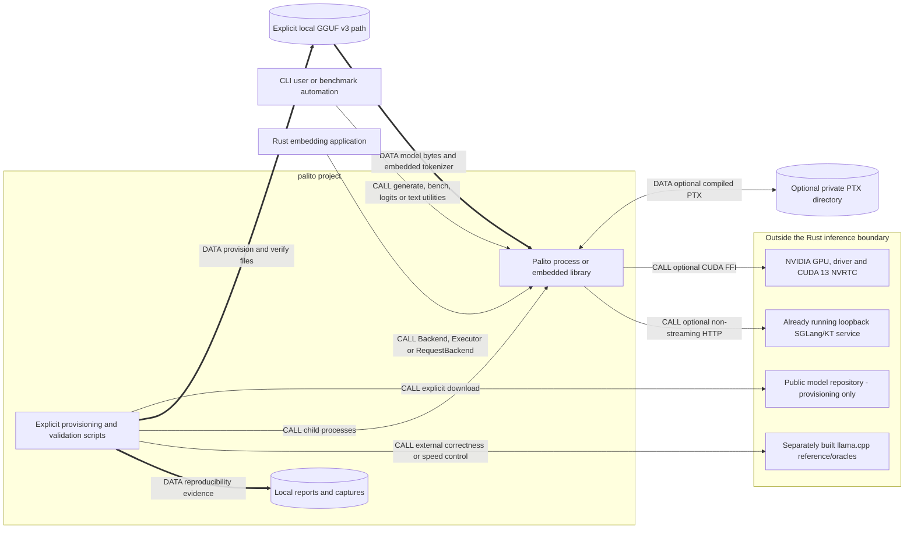
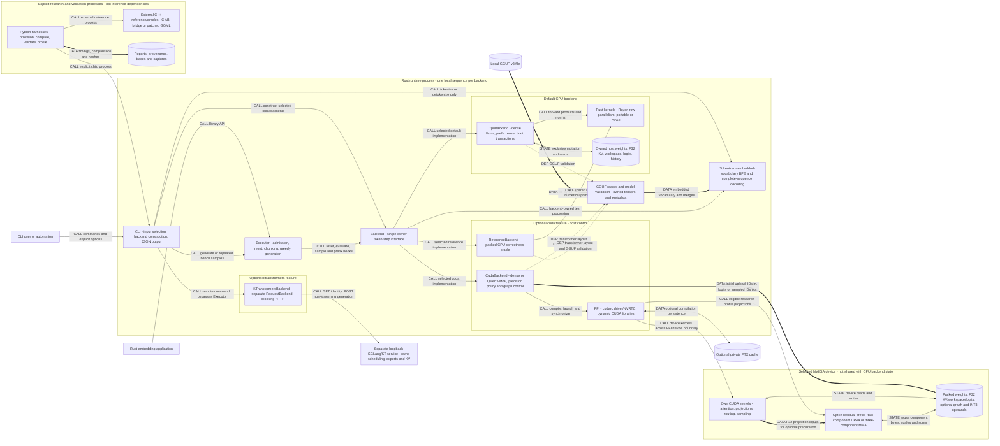
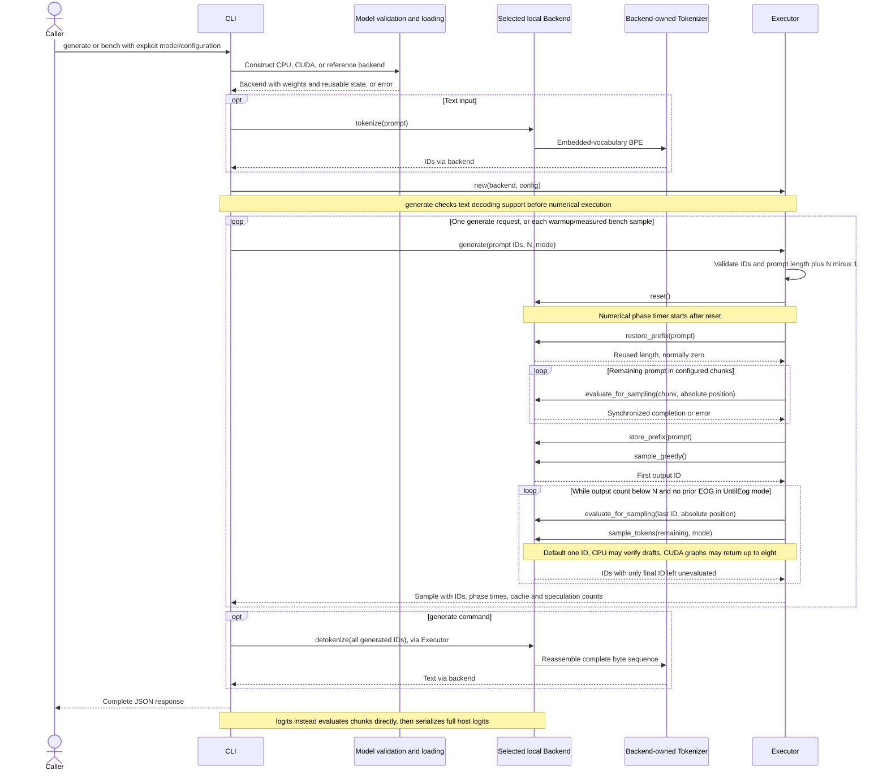
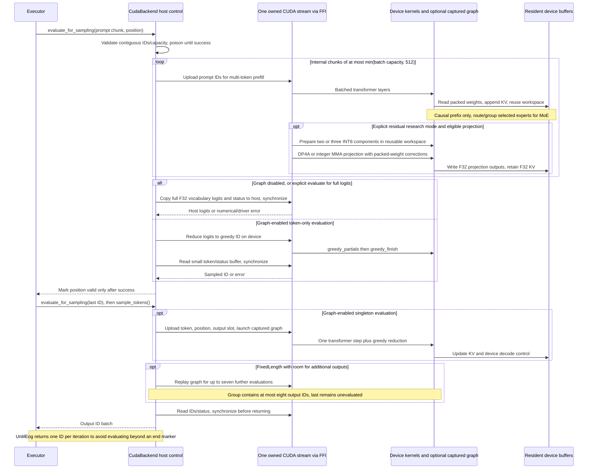
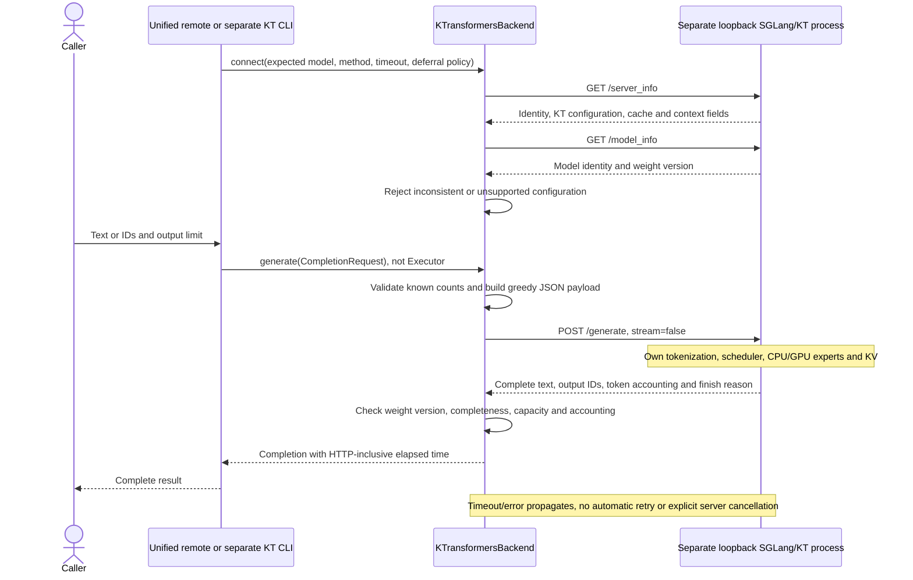
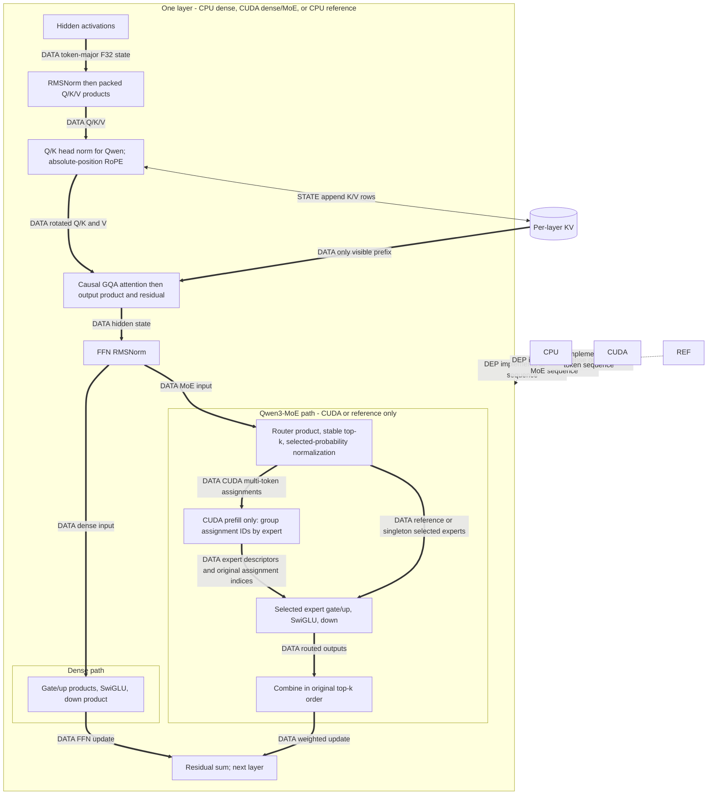
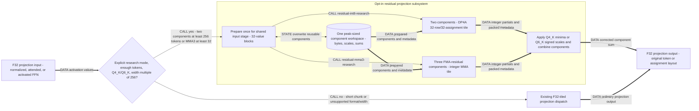
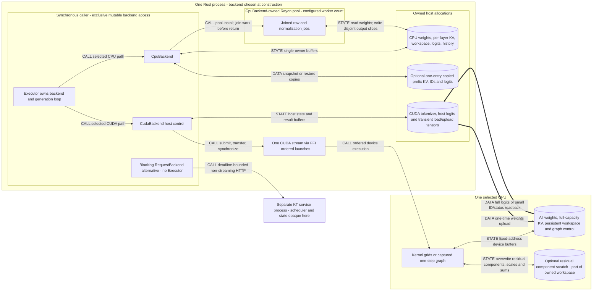

# Architecture: Palito, an independent Rust GGUF engine

> Paths under `results/` name local run outputs (JSON checkpoints and summaries) that are not committed to the repository.

## Scope, revision, and evidence

This is a model of **the working tree refreshed on 2026-11-17**, including the
completed 21:46 UTC small-prefix MMA3 acceptance checkpoint, not a roadmap or a
directory diagram. Paths below are relative to the `palito`
repository root. Prefer named symbols over line positions when subsequent edits
move code.

- Analyzed HEAD: `1cf41764d3484899bb104b17d4a89eeb0e06d2a6`
  (`Initial commit of Rust inference runtime and literature review`).
- The executable project is the single Cargo package in
  [Cargo.toml](../Cargo.toml). There is no top-level Cargo workspace.
  The package exposes a library, the `palito` binary, an optional
  `ktransformers` binary, and three CUDA-gated diagnostic examples.
- Existing changes were preserved. Tracked modifications cover the root ignore
  rules, runtime README, M8 report, CUDA capture example, iteration/paired
  benchmark scripts and benchmark tests, main CLI, CUDA backend/batching/
  diagnostics, grouped/packed/prefill experiments, CUDA attention/kernels, and
  CUDA integration tests. Untracked CUDA sources include `model_quality.rs`,
  `model_replay.rs`, `residual.rs`, `residual.cu`, `residual_tile.cu`,
  `residual_precise.rs`, `residual_precise.cu`, and `residual_mma.cu`.
  Local `llama.cpp/` and `vllm/` trees are also untracked at the parent boundary.
- No applicable `AGENTS.md` was found in the project root or runtime subtree.
  Instructions inside the separate external trees do not define runtime behavior.
- **Refresh boundary:** the earlier concurrent CUDA/batching/CLI changes are now
  incorporated, including runtime residual arithmetic, reusable quantization
  workspace, profile-gated normalized attention, and ignored full-model quality
  tests. At refresh, all **38 source/configuration entries** in the latest
  candidate provenance (`results/cuda-runtime-m8-mma3-small-acceptance/paired/b1/provenance.json`)
  matched the working tree by SHA-256. This checks recorded source identity, not
  a newly rebuilt executable or completeness of the manifest.
- Source, manifest, native reference adapters, tests, scripts, existing benchmark
  reports, and selected local result manifests were inspected. No application
  changes, dependency installation, model download, inference, or benchmark run
  was performed for this document.

**Evidence classes:** **F** = verified implementation fact; **M** = existing
measurement, not reproduced here; **H** = hypothesis requiring measurement;
**U** = unresolved or out of scope. Numerical quality results are not performance
measurements, and source inspection alone cannot prove a bottleneck.

The [runtime README](../README.md) remains the operational index.
The literature review, especially section 6,
discusses alternatives; those are not automatically implemented here.

## 1. System context and supported scope

**F:** The ordinary runtime is an offline, synchronous completion engine, not a
server. It loads a user-specified file; there is no model registry, discovery
daemon, automatic download, listener, chat-template layer, token stream, or
request scheduler. The remote adapter calls an existing service; it does not
launch one. Provisioning scripts and benchmark service launchers are separate
entry points ([main.rs](../src/main.rs), `Command`;
[download_model.py](../scripts/download_model.py), `main`, line 11;
[benchmark_moe.py](../scripts/benchmark_moe.py), `server`, line 85).

| Execution choice | Architecture and numerical scope | Important boundary |
| --- | --- | --- |
| Default CPU | Dense decoder-only `llama`; one sequence; packed weights, F32 activations/KV, portable or runtime-guarded AVX2 | Own Rust math; no BLAS, GGML, llama.cpp, or CUDA |
| `cuda` + `--backend cuda` | Dense `llama` or `qwen3moe`; all weights/experts resident on one GPU; F32 activation/KV storage with optional residual-quantized prefill operands | Own CUDA kernels; dynamically loaded driver/NVRTC; no CPU-expert offload. Research arithmetic is explicitly selected, not the default |
| `cuda` + `--backend reference` | Same model layouts as CUDA, sequential packed CPU oracle | Shares parser/layout and CPU primitives; not the optimized CPU backend and not a fully independent parser oracle |
| `ktransformers` + `remote`, or separate KT binary | Whole completion delegated to loopback SGLang/KT | Service owns tokenizer execution for text, token steps, placement, scheduling, and KV; no local token-step access |

Sources: [Cargo.toml](../Cargo.toml), features and targets, lines 10-48;
[cpu.rs](../src/cpu.rs), `CpuBackend::open_with_options`, line 245;
[transformer.rs](../src/transformer.rs), `Weights::open`, line 82;
[cuda.rs](../src/cuda.rs), `CudaBackend::open`;
[reference.rs](../src/reference.rs), `ReferenceBackend`, line 41;
[backend.rs](../src/backend.rs), `Backend` and `RequestBackend`,
lines 53 and 185.

## 2. Master architecture

The editable standalone source is [architecture.mmd](architecture.mmd).
This embedded chart is identical; edit both together.

### Diagram notation and stable identifiers

- `-->` with **CALL**: runtime invocation/control, including synchronous FFI/HTTP.
- `==>` with **DATA**: payload movement, not a static import.
- `-.->` with **DEP**: compile-time/shared-code dependency, not a process launch.
- `<-->` with **STATE**: reads/writes of owner-controlled state, **not** evidence
  of a mutex or cross-request sharing. Bidirectional **DATA** means transfers.
- Subgraphs identify process/component/device boundaries. Optional components
  exist only with their feature/configuration; a chart edge does not mean all
  backends run in one request. Ordinary boxes are code/actors; cylinders are data.
- IDs such as `CLI`, `EXEC`, `BAPI`, `CPU`, `CUDA`, `REF`, `KT`, `GPUK`,
  `CPSTATE`, and `GPUSTATE` keep their meaning in every view. Focused views add
  child IDs, and sequence diagrams use named participants and normal Mermaid
  call/return arrows.

`BAPI` is a logical interface, not a scheduler or concrete factory. Construction
is the CLI's `ModelArgs::open`; embedding callers construct a concrete backend
themselves. `Box<dyn Backend>` forwarding preserves hooks, including multi-token
sampling. `REF` is grouped with the CUDA feature for compilation only: it executes
on the CPU and never calls CUDA. The master chart elides its separate host KV and
thread pool, expanded in the resource table below.

### Public and internal contracts

| Boundary | Responsibility and invariant | Source |
| --- | --- | --- |
| CLI input/output | Exactly one of prompt, prompt file, or JSON token-ID file; complete JSON response after work. `logits` bypasses `Executor` and evaluates chunks directly | [main.rs](../src/main.rs), `ModelArgs`, line 77; `execute`, line 339 |
| `Executor<B: Backend>` | Owns one backend and validated `Config`; manages request admission, reset, prefill chunks, greedy/EOG policy, output IDs, and timing | [lib.rs](../src/lib.rs), lines 77-194 |
| `Backend` | Exclusive `&mut self` execution, explicit positions, reset after failed work; synchronous `evaluate` exposes host logits, while `evaluate_for_sampling` may avoid them | [backend.rs](../src/backend.rs), lines 44-93 |
| Shared model loading | GGUF v3 tensor directory/type/bounds/finite validation; CPU extracts dense layout independently, CUDA/reference use generic `Weights<T>` plus `Spec` | [gguf.rs](../src/gguf.rs), `Gguf::parse`, line 239; [transformer.rs](../src/transformer.rs), `Weights`/`Spec`, lines 13-82 |
| `RequestBackend` | Whole-request result and elapsed time, not token-step capability or isolated numerical phases | [backend.rs](../src/backend.rs), lines 138-188 |
| Errors | `Invalid`, `Backend`, I/O and JSON errors propagate as `Result`; CLIs print an error and exit 1. No automatic backend fallback | [lib.rs](../src/lib.rs), `Error`, line 19; [main.rs](../src/main.rs), `ModelArgs::open` and `main` |

## 3. Initialization and end-to-end execution

### 3.1 Model loading and input preparation

**F:** `--model` is an explicit path. `Gguf::open` reads the whole file into a
temporary byte vector, validates metadata/directory/alignment/nonoverlap/finite
payloads, and copies tensors into owned vectors. F32 and rank-one tensors are
expanded to F32; other matrices remain packed unless CPU `--f32-weights` is set.
Allowed formats are F32, F16, Q5_0, Q8_0, Q4_K, and Q6_K. There is no mmap, demand
paging, model sharding, or cross-backend weight sharing
([gguf.rs](../src/gguf.rs), `layout`, line 145; `open`, line 226;
`parse`, line 239).

CPU model validation and numerical admission precede KV/workspace allocation but
**follow weight loading**. The private Rayon pool is constructed once.
CUDA initialization checks Linux and CUDA libraries, creates a device context,
compiles or reads PTX and loads functions **before** reading the model, then
validates layout and device-buffer admission, allocates buffers, uploads tensors,
synchronizes, and optionally captures a decode graph
([cpu.rs](../src/cpu.rs), lines 245-483;
[cuda.rs](../src/cuda.rs), `CudaBackend::open`).
Thus even an incompatible model can incur CUDA library/JIT work before rejection.

Tokenizer construction validates embedded tokens/types, byte mappings, merge
ranks, special tokens, and BOS/EOS settings. Supported metadata is
`gpt2/smollm` or `gpt2/qwen2`; Qwen ordinary pieces use NFC normalization.
Ordinary pieces use regex splitting and rank/leftmost BPE merges maintained by a
heap. Special/control-token recognition precedes ordinary-piece processing.
There is no automatic chat template. Decoding reassembles the whole byte sequence,
omits controls, preserves user-defined tokens, rejects unused/out-of-range IDs,
and replaces invalid UTF-8 ([tokenizer.rs](../src/tokenizer.rs),
`from_metadata`, line 51; `bpe`, line 189; `tokenize`, line 279;
`detokenize`, line 310).

**Source-over-description detail:** `Tokenizer::open` parses only metadata but
`Gguf::read_metadata` still calls `fs::read` on the **entire GGUF file**.
It avoids tensor expansion, not full-file I/O/allocation. Backends retain tokenizer
construction as `Result<Tokenizer>` so raw-ID numerical APIs can remain usable
when text support fails. However, CLI `generate` explicitly calls
`detokenize(&[])` before inference, even for ID input; `bench` and `logits` with
IDs do not require text decoding ([gguf.rs](../src/gguf.rs), line 230;
[cpu.rs](../src/cpu.rs), line 307;
[main.rs](../src/main.rs), `execute`, `Generate` branch).

### 3.2 Local completion, benchmark samples, and full-logit output

Source: [lib.rs](../src/lib.rs), `Executor::generate`, line 117;
[main.rs](../src/main.rs), `execute`, line 339.

Important semantics:

- For `P` prompt tokens and `N` outputs, only `P + N - 1` positions need
  evaluation: the final sampled token is not evaluated. Exact context capacity
  is accepted. `UntilEog` includes the EOG in returned IDs; `FixedLength`
  intentionally ignores it. CPU uses its configured EOS; CUDA/reference also
  recognize the Qwen control end markers collected by `Weights::open`.
- `generate` loads once, runs once, and decodes once. `bench` loads once and
  reuses its backend across sequential warmups/samples, each starting with
  active-state reset. Prefix caching, if explicitly enabled, survives reset.
  There is no per-request model reload inside `Executor`.
- CPU normal `forward` projects only the final token of **each evaluate batch**,
  including intermediate public prefill chunks. CUDA skips final projection on
  intermediate **internal** chunks, but projects the last token of each public
  `evaluate` call. Neither path skips all intermediate public-chunk logits.
  Draft verification needs logits for every proposed position.
- `prefill_ns` includes prefix restore/store and prompt evaluation, but excludes
  model load, input tokenization, and reset. `ttft_ns` adds first sampling;
  it is not user-visible streaming TTFT. `decode_ns` covers remaining `N-1`
  outputs, including speculation/graph replay work; one output means zero decode
  time. CLI `load_ns` excludes tokenization and final output serialization.

Sources: [cpu.rs](../src/cpu.rs), `forward`, lines 584-625;
[cuda.rs](../src/cuda.rs), `evaluate_inner`;
[transformer.rs](../src/transformer.rs), EOG construction, lines 185-214;
[lib.rs](../src/lib.rs), lines 123-194.

### 3.3 CUDA execution and optional captured decode

This is a logical grouping: code performs the first readback inside evaluation,
then `sample_tokens` may perform a second grouped replay/readback. It does not
promise a single transfer for the entire loop. Singleton non-graph evaluation
uses `step`; the multi-token branch uses `batched_prefill`.

**F:** One stream orders launches; Q/K/V calls are issued sequentially on it, not
on parallel streams. Normal `evaluate` downloads all vocabulary logits and status
and synchronizes. With `--cuda-decode-graph`, a bounded graph is captured at open
and reused at fixed buffer addresses; device control carries token, position,
and output slot. Host logits are explicitly unavailable after token-only
evaluation, rather than returning stale data. Graph mode requires head dimension
at most 256 and configured context at most 1024. It does not capture whole
requests or multi-token prefill. Until-EOG generation samples one token at a time.

Sources: [cuda.rs](../src/cuda.rs), `finish_evaluation` and
`evaluate_inner`; [decode.rs](../src/cuda/decode.rs),
`capture_decode_graph`, line 42; `read_decode_tokens`, line 124;
`sample_decode_tokens`, line 146; [decode.cu](../src/cuda/decode.cu),
`greedy_finish`, line 73.

### 3.4 Whole-request KTransformers delegation

**F:** The client permits plain loopback HTTP origins only, disables proxies,
redirects, and automatic retries, bounds responses to 8 MiB, and uses a blocking
reqwest client with deadlines (connect timeout at most 10 seconds, default
request timeout 300 seconds). No Tokio executor is explicitly managed by project
code; reqwest's internal transport machinery is outside this ownership model.
Every exchange has its own deadline, not one deadline covering the whole handshake.
Positive expert deferral requires explicit opt-in. The handshake checks reported
configuration, not cryptographic model identity or actual per-expert placement.
Missing context is reported as unknown, not invented.

The separate KT CLI provides `info`, `run`, and `bench`. Its benchmark rejects
enabled server radix cache and nonzero cached work; the client never flushes the
service cache. Runtime calls do not stop the external service. Sources:
[ktransformers.rs](../src/ktransformers.rs), `endpoint_url`, line 85;
`exchange`, line 117; `connect`, line 167; `generate`, line 261;
[bin/ktransformers.rs](../src/bin/ktransformers.rs), `execute`, line 71.

## 4. Transformer and MoE subsystem

After all layers, final RMSNorm and tied embedding or separate output weights
produce next-token logits. For batches, future KV rows may already be written,
but each query reads only through its absolute position. CPU normal attention
iterates tokens/heads on the pool's executing thread; CPU products and selected
normalization loops use Rayon parallel iterators. Reference evaluation iterates
tokens serially and allocates temporary vectors per step/layer; it is a
correctness aid, not a throughput competitor
([cpu.rs](../src/cpu.rs), `attend`, line 199; `forward`, line 485;
[reference.rs](../src/reference.rs), `step`, line 92;
[batch.rs](../src/cuda/batch.rs), `batched_prefill`).

CUDA routing uses lowest-index tie breaks and renormalizes probabilities over
the selected top-k. Assignment ID is `token * used + routing_slot`; grouping
reorders work for reuse, then kernels scatter into original assignment layout
and `combine_batch` sums in original top-k order. No expert weights move between
CPU/GPU during this path
([kernels.cu](../src/cuda/kernels.cu), `router`, line 370;
`combine_batch`, line 446; [prefill.cu](../src/cuda/prefill.cu),
`group_expert_tiles`, line 79).

### Active versus experimental kernel selection

| Choice | Current implementation, not a recommendation |
| --- | --- |
| Default CUDA `f32` | Packed matrix-vector decode; four-token prefill weight reuse and four-assignment expert groups |
| `f32-tiled` | Opt-in F32 arithmetic with packed Q4_K/Q6_K decode and native finite-half scale conversion; staged eight-assignment expert fallback; specialized 32-assignment register experts for chunks >=256, width 2048, hidden 768, 128 experts/top-8, and all expert projections Q4_K/Q6_K |
| Guarded dense tiles within `f32-tiled` | At chunks >=256 and Q4_K/Q6_K, `(input, output)` widths `(2048,4096)`, `(4096,2048)`, `(2048,512)` select reference-order 2-row/16-token tiles; other shapes retain existing projection dispatch |
| `tf32`, `tf32x3`, `tf32x3-tiled` | Explicit approximate tensor-core experiments, requiring compute capability >=8.0; F32 storage does not make their arithmetic exact. Single TF32 and tiled TF32x3 have recorded strict quality failures; bounded TF32x3 successes are not universal equivalence |
| `residual-int8-research` | Explicit runtime research mode, compute capability >=6.1. Eligible prefill chunks >=256 use two symmetric INT8 activation components and 32-row/32-assignment DP4A tiles. Full-model quality failed; this is not an admitted inference profile |
| `residual-mma3-research` | Explicit runtime research mode, compute capability >=8.0. Eligible prefill chunks >=32 use three FMA-residual INT8 components and integer tensor-core MMA tiles. Latest finite-corpus quality and performance gates pass; scoped opt-in admission is not default/production promotion |
| Fused attention | Multi-token prefill uses shared-memory scores when configured context <=1024 and head dimension <=256. Larger supported configurations use global score buffers. Non-graph singleton `step` uses score/value kernels; graph singleton uses fused attention. MMA3 alone normalizes each shared score once before the value loop; default/F32-tiled arithmetic is unchanged |
| Prototypes | `CUDA_M8_PROTOTYPES`, `LOCAL_DECODE_BENCH`, alternative tiles/fusion and TF32x4 controls remain non-default/test research. Rust research harness modules are test-gated, but residual CUDA source is also compiled into explicitly selected runtime research profiles |

Dispatch evidence: [cuda.rs](../src/cuda.rs), `CudaMatmul`,
`register_group_shape`, and `CudaBackend::open` source defines/function loading;
[batch.rs](../src/cuda/batch.rs), `reference_dense_shape`,
`residual_projection`, `prepare_residual!`, `project_residual!`, and
`batched_prefill`; [kernels.cu](../src/cuda/kernels.cu),
`half_value`, line 4; [prefill.cu](../src/cuda/prefill.cu),
prototype guards starting at line 232; [tensorcore.cu](../src/cuda/tensorcore.cu),
TF32x4 prototype guard, line 210.

Not every kernel name in a compiled source is invoked by production dispatch.
In particular, Rust modules named `prefill`, `packed_decode`, `grouped_bench`,
`arithmetic`, `model_replay`, `model_quality`, `residual`, and `residual_precise`
are under `#[cfg(test)]`;
production batching is in `batch.rs`, and production CUDA prefill source is
`prefill.cu` ([cuda.rs](../src/cuda.rs), test-gated module declarations).
Do not confuse those Rust harness modules with runtime `include_str!` of
`residual.cu`/`residual_tile.cu` for two-component research or
`residual.cu`/`residual_precise.cu`/`residual_mma.cu` for MMA3.
Older matrix-only evidence (`results/cuda-runtime-m8-residual-matrices/checkpoint.json`)
predates full-model integration. The later
two-component rejection (`results/cuda-runtime-m8-int8-model/checkpoint.json`)
and MMA3 small-prefix admission (`results/cuda-runtime-m8-mma3-small-acceptance/checkpoint.json`)
supersede it for those explicit modes, not for defaults.

### Residual prefill arithmetic and fallback boundaries

**F:** The guard uses each **internal prefill chunk's** length, not total prompt
length or configured capacity. Q/K/V share one preparation of normalized inputs;
gate/up share another. Attention-output and down projections prepare their own
inputs. One scratch allocation is overwritten across all stages/layers rather
than retaining four sets of component buffers. Expert gate/up/down switch
together only if all three are eligible; 32-assignment expert descriptors preserve
the original routing-slot output layout. Unsupported/short paths explicitly use
the existing F32-tiled family, with its normal shape guards. Router, output-vocabulary
projection, singleton decode products and KV storage remain F32.

The two-component path approximates each input with two scaled signed INT8
vectors; the MMA3 quantizer forms three components using explicit FMA residuals,
then executes integer MMA with metadata-group-bounded integer accumulators.
Q4_K needs minima/activation-sum corrections, while Q6_K retains its signed
subgroup scales. Output is F32, but these paths are **not exact F32 arithmetic**.
Nonfinite conversion/reconstruction/output sets device status and poisons the
request until reset. Source comments still calling the MMA/precise CUDA files
"test-only" are stale relative to their explicit runtime inclusion.

Sources: [cuda.rs](../src/cuda.rs), `CudaMatmul::residual_min_tokens`,
`residual_workspace_elements`, `CudaBackend::open`;
[batch.rs](../src/cuda/batch.rs), `residual_projection`, macros and
`integer_groups`; [residual.cu](../src/cuda/residual.cu),
`residual_quantize32`, `residual_parameters`;
[residual_tile.cu](../src/cuda/residual_tile.cu), `residual_matmul32`;
[residual_precise.cu](../src/cuda/residual_precise.cu),
`residual_quantize32_precise3`;
[residual_mma.cu](../src/cuda/residual_mma.cu), `residual_matmul_mma3`;
[attention.cu](../src/cuda/attention.cu), `CUDA_NORMALIZED_ATTENTION`.

## 5. Execution, ownership, resources, and lifecycle

### Ownership and memory accounting

Let `L` be layer count, `C` context capacity, `p` live positions, `Dkv` KV heads
times head dimension, `B` batch capacity, `S` speculative window, and `V` vocabulary.

| Resource | Owner, lifetime, sharing, and bound |
| --- | --- |
| CPU weights | Owned `Tensor` vectors in one backend; immutable during requests; shared by references within Rayon jobs, not an `Arc<Model>` across backends. Packed blocks decode into bounded worker scratch |
| CPU active KV | Two preallocated F32 vectors per layer: `8 * L * C * Dkv` payload bytes; live bytes `8 * L * p * Dkv`. Reset and rollback hide rows, not free or securely erase them |
| CPU workspace/logits/history | Backend-owned, reused at fixed capacity. Workspace depends on batch/width/hidden/context and includes `4 * S * V` verification bytes plus saved logits; history reserves `4 * C`, main logits `4 * V`. Counted worker scratch bound is `threads * 1056` bytes, not thread-stack memory |
| Prefix snapshot | One private immutable copied prefix, logits, and per-layer KV; capacity capped by the largest full-context snapshot. Survives reset only when enabled; replacement evicts before allocating, oversized snapshots are skipped |
| CPU transactions | A single append transaction saves logits and a visibility position. `Arc<()>` owner identity and serial reject foreign/stale/nested handles; this is not shared model state or a lock |
| Reference state | Separate CPU-owned weights, KV, logits, Rayon pool; temporary activations/scores per step and per-layer temporary work. No optimized memory report, prefix reuse, speculation, or numerical budget |
| CUDA weights/KV/workspace | One backend/device, all experts resident. Same F32 KV formula; prefill activation capacity `min(B,512)`, routing/grouping descriptors, score fallback, device logits, and optional graph control preallocated |
| Residual component workspace (`QWORK`) | Optional subset of CUDA workspace, not a second model or retained KV format. `N` is the maximum of batched hidden/query/expert-gate capacities, rounded to 32. For `k` components, payload is `k*N + 8*k*(N/32)` bytes: signed-byte values plus F32 scales and i32 sums. Only the selected profile's workspace is allocated, and none when batch capacity is below its eligibility threshold |
| CUDA host/loading state | Own tokenizer/host logits; initial full file and owned host tensors coexist during loading; uploading consumes tensors progressively and can create byte staging for F32 tensors. Not included in device allocation report |
| CUDA graph | Own captured graph references fixed buffers/modules. Decode control/sampling buffers are counted; driver/JIT/graph-internal allocations are not. Graph must be destroyed before referenced allocations |
| External service | Owns independent state/resources. Client retains one reusable HTTP client and reported identity, but has no handle to service KV or admission queues |

Sources: [cpu.rs](../src/cpu.rs), state structs, lines 22-159;
allocation/admission, lines 315-483; transactions/prefixes, lines 634-931;
[kernels.rs](../src/kernels.rs), `packed_row`, line 16;
[reference.rs](../src/reference.rs), lines 41-110;
[cuda.rs](../src/cuda.rs), `DeviceTensor::upload`, `Workspace`,
`workspace_sizes`, and `CudaBackend::open` admission/allocation;
[decode.rs](../src/cuda/decode.rs), `DecodeState`, line 4.

For the recorded Qwen3 shape at batch 512, two components add **7,864,320 bytes**
and MMA3 adds **11,796,480 bytes (11.25 MiB)** over F32-tiled. At batch 32,
MMA3 adds **737,280 component bytes plus 12,096 group-descriptor bytes**; below
32 it adds neither. Batch512 descriptors already cover tile32, so the latest
small-prefix extension adds no memory over the earlier MMA3 profile.
These are accounted reservations, not GPU RSS or input-dependent live occupancy
([cuda.rs](../src/cuda.rs), `residual_workspace_bytes`,
`group_workspace_elements`, and `Workspace::new`;
small-capacity report (`results/cuda-runtime-m8-mma3-small-model/small-capacity-summary.json`)).

**F:** CPU `--memory-limit-bytes` limits counted numerical reservations, not RSS,
file-loading peaks, metadata, allocator/container overhead, worker stacks, or
caller-owned outputs. CUDA's default owned-buffer budget is 24 GiB and admission
also preserves 2 GiB of **currently** free device memory. This is a snapshot
check, not a reservation against other users/processes. It is not a host-memory
limit and cannot guarantee later allocations under competition.
Reducing batch reduces workspace, not full-context KV. These paths do not
silently shrink workspace, quantize activations, or fall back to another device
when admission fails ([cpu.rs](../src/cpu.rs), lines 315-386;
[cuda.rs](../src/cuda.rs), `admit`).

### Concurrency and backpressure

- **F:** A local backend owns one contiguous sequence position and one active
  logits state. `&mut self` serializes access through the public execution API;
  `Backend` does not require `Send`/`Sync` and contains no request queue.
  Configured batch/chunk means tokens of one sequence, **not** continuous batching.
- **F:** CPU work uses a private configured Rayon pool; jobs divide tensor output
  rows and some normalization/transpose slices. Rayon schedules and joins those
  jobs internally. There is no application-level channel, semaphore, queue
  capacity, cross-request mutex, or async scheduler. Multiple independent
  backends would duplicate weights/state/pools unless an embedding application
  adds different ownership.
- **F:** CUDA has one ordered stream per backend, using a default stream normally
  or a new stream with cudarc event tracking disabled for graph mode. Shared
  `Arc` handles keep stream/context lifetimes alive; they do not establish
  concurrent inference. Device kernels use block barriers, warp shuffles, and
  status atomics, distinct from host request synchronization.
- **F:** Local admission rejects over-capacity inputs instead of queueing.
  Synchronous completion imposes caller-side waiting; it is not a defined
  service-level backpressure policy. The remote service's scheduling/queue
  internals are not established by this client implementation.
- **F:** Python benchmark orchestration adds subprocesses, a GPU telemetry
  thread, and explicit owned-service lifecycle management. Model provisioning
  can use a four-worker download pool. Those are tooling concurrency, not runtime
  token parallelism ([benchmark_cuda_iteration.py](../scripts/benchmark_cuda_iteration.py),
  `monitor`/`run`, lines 137-188;
  [download_moe_models.py](../scripts/download_moe_models.py), line 91).

### Reset, speculation, errors, persistence, and cleanup

CPU reset invalidates logits, position, history, transaction, failure state, and
speculation counters without zeroing KV. The optional prefix survives; restore
requires the entire saved token prefix to match `prompt.starts_with`. It is not
a longest-common-prefix trie. Restore copies cached rows into active KV.
N-gram speculation searches recent history for suffixes of length at most four,
verifies a bounded draft causally in one batch, keeps only the greedy-matching
prefix, and restores/truncates logits/history/position on rejection. Rejected
rows remain allocated but invisible. It uses no second model
([cpu.rs](../src/cpu.rs), `verify_draft`, line 708; `propose`, line 755;
`reset`, line 791; prefix and sampling hooks, lines 844-931).

CPU numerical evaluation errors invalidate logits and mark the backend failed;
reset or a valid transaction rollback is required. CUDA `State::begin` poisons
the request before submissions; only successful synchronized completion advances
valid state. Reset synchronizes, clears status and host sampling/capture state,
and retains allocations. The next `Executor::generate` always resets after
admission, so a failed previous request does not intentionally resume partially
written KV. Invalid input rejected before numerical work does not advance state
([cpu.rs](../src/cpu.rs), lines 683-750 and 801-820;
[cuda.rs](../src/cuda.rs), `State` and `Backend::reset`;
[lib.rs](../src/lib.rs), line 139).

There is **no cooperative cancellation API, signal handler, streamed token
callback, or request deadline** in local execution. HTTP timeouts stop the client
wait; they do not constitute an explicit service-abort protocol. Benchmark
subprocess deadlines and process-group cleanup are external controls, and their
code explicitly reports incomplete cleanup for kernel-blocked children rather
than claiming guaranteed device cancellation
([benchmark_cuda_iteration.py](../scripts/benchmark_cuda_iteration.py),
`capture_process`, line 25).

Rust-owned vectors/pools/handles are released through ordinary ownership teardown.
CUDA's `Drop` synchronizes and records driver teardown errors in the context;
it cannot return a `Result` to the caller. Captured references are placed before
their referenced fields for destruction. The external C++ reference separately
uses RAII to free native batch/sampler/context/model handles
([decode.rs](../src/cuda/decode.rs), lines 34-65;
[cuda.rs](../src/cuda.rs), `CudaBackend` field order;
[bridge.cpp](../native/bridge.cpp), `li_handle`, line 12).

Persistent runtime state is limited to the opt-in PTX cache, not model/KV
checkpoints. Its key covers CUDA source, compile options/target, NVRTC-reported
version, and Cargo lockfile; entries validate a PTX checksum and are published
using synced temporary files and rename. Corruption/I/O errors fail explicitly.
This is a trusted private cache, not an authenticated artifact distribution
mechanism; driver/NVRTC remain necessary on hits
([cache.rs](../src/cuda/cache.rs), lines 18-118).
Reports/captures and downloaded model files are separate persistent artifacts;
there is no database or conversation persistence subsystem.

## 6. Diagnostics, external controls, and evidence boundaries

**F:** Production diagnostic capture is opt-in on a fresh CUDA backend, excludes
decode graphs and singleton internal chunks, and records selected projections
and per-layer routing. It introduces explicit device copies/synchronization and
bounded retained host records, so capture timings are not ordinary inference
timings. Saving creates a new JSONL file; reset cancels capture. Its byte budget
does not bound JSON encoding size or all staging memory
([diagnostics.rs](../src/cuda/diagnostics.rs), lines 20-59, 149-228,
and 333-397; [cuda_capture.rs](../examples/cuda_capture.rs), `main`, line 50).

The reference tracer records chosen token/layer intermediates; `cuda-precision`
supports numerical investigation. Model-backed projection replay and full-model quality
research use ignored tests with bounded capture/model/routing guards. Those
harnesses exercise the explicit runtime research modes; they are not a new
serving endpoint. Captured routing with synthetic matrix operands is not a
full-model inference benchmark
([reference.rs](../src/reference.rs), `trace_at`, line 76;
[model_replay.rs](../src/cuda/model_replay.rs), ignored entry points,
lines 274-289; [grouped_bench.rs](../src/cuda/grouped_bench.rs),
`parse_routing`, line 381).

**F:** Cargo does not build the native bridge or link llama.cpp/GGML. The native
CMake project is explicitly built as an external reference, with a C ABI between
the C++ control executable and shared bridge, then llama.cpp/GGML. The separate
F32-activation oracle patches a pinned external worktree to isolate arithmetic
differences. Neither is called by Rust numerical inference. The retained legacy
Rust FFI/backend/build files are not current Cargo targets
([Cargo.toml](../Cargo.toml); [CMakeLists.txt](../native/CMakeLists.txt),
lines 15-22; [reference.cpp](../native/reference.cpp), `main`, line 28;
[bridge.cpp](../native/bridge.cpp), `li_eval`, line 164;
[build_f32_oracle.py](../scripts/build_f32_oracle.py), lines 10-73;
[legacy/build.rs](../benchmarks/legacy/build.rs), historical only).

**F:** Benchmark harnesses run explicit engines/services sequentially and retain
commands, IDs, timings, hashes, linkage, and environment evidence. Cross-engine
token equality is observed rather than assumed because arithmetic can differ.
Local phase time, external C++ phase time, and service HTTP latency are not
interchangeable metrics. **Known stale text:** the final `limitations` strings
in `benchmark_rust.py` still describe expanded F32 weights and sequential Rust
prefill, even for packed/batched runs. Inspect actual command/options, memory
objects, source hashes and numerical comparisons rather than accepting those
strings as current architecture
([benchmark_rust.py](../scripts/benchmark_rust.py), lines 79-170;
[benchmark_moe.py](../scripts/benchmark_moe.py), `main`, line 170).

## 7. Subsystem coverage

Every major runtime or supporting subsystem is accounted for below. Deliberate
omissions avoid promoting directory contents into active architectural roles.

| Subsystem | Status and diagram nodes | Evidence / omission rationale |
| --- | --- | --- |
| CLI, input/output, command configuration | Active: `CLI`, `CALLER` | [main.rs](../src/main.rs), `Command`; `execute`, line 339 |
| Library policy, admission, reset, timers | Active: `EXEC`, `BAPI` | [lib.rs](../src/lib.rs), `Executor`, line 77; [backend.rs](../src/backend.rs), line 53 |
| GGUF parser, quantized storage, layout validation | Active: `LOADER`, `MODEL` | [gguf.rs](../src/gguf.rs), line 239; [transformer.rs](../src/transformer.rs), line 82 |
| Embedded BPE and full-sequence decoder | Active: `TOKENIZER` | [tokenizer.rs](../src/tokenizer.rs), line 33 |
| Dense CPU engine and kernels | Active default: `CPU`, `CKERN`, `CPSTATE` | [cpu.rs](../src/cpu.rs), line 485; [kernels.rs](../src/kernels.rs), line 231 |
| Prefix snapshot, transactions, n-gram speculation | Implemented, opt-in: `CPU`, `PREFIX` | [cpu.rs](../src/cpu.rs), lines 634-931; no separate process/draft model |
| CUDA initialization, memory admission, FFI/JIT | Feature-gated: `CUDA`, `CUDAAPI`, `GPUSTATE`, `KCACHE` | [cuda.rs](../src/cuda.rs), `CudaBackend::open`; [cache.rs](../src/cuda/cache.rs), line 32 |
| CUDA prefill, dense/MoE math and kernel dispatch | Feature/profile-gated: `GPUK`, focused forward nodes | [batch.rs](../src/cuda/batch.rs), `batched_prefill`; [kernels.cu](../src/cuda/kernels.cu); [prefill.cu](../src/cuda/prefill.cu) |
| Residual preparation, integer projections, scratch, normalized attention | Explicit research-profile runtime paths: `RESIDUAL`, `QWORK`, `GPUSTATE`, `GPUK` | [cuda.rs](../src/cuda.rs), `CudaMatmul`, workspace/admission and JIT selection; [batch.rs](../src/cuda/batch.rs), actual-chunk/format/width dispatch; [attention.cu](../src/cuda/attention.cu), MMA3-only score normalization |
| Captured decode and device greedy sampling | Opt-in: `CUDA`, `GPUK`, `GPUSTATE` | [decode.rs](../src/cuda/decode.rs), line 42; [decode.cu](../src/cuda/decode.cu), line 51 |
| Packed CPU transformer oracle | Active selectable, CUDA feature only: `REF`, `CKERN` | [reference.rs](../src/reference.rs), line 41; own host state elided from master |
| KTransformers adapter and second CLI | Feature-gated: `KT`, `KT_SERVICE` | [ktransformers.rs](../src/ktransformers.rs), line 167; [bin/ktransformers.rs](../src/bin/ktransformers.rs), line 71 |
| Diagnostic capture, traces, precision tools | Active opt-in APIs/examples: `CUDA`, `REF`, `REPORTS` | [diagnostics.rs](../src/cuda/diagnostics.rs), line 333; examples are not default inference paths |
| Arithmetic/grouped/packed/prefill/model replay/residual/quality research | Rust harnesses test-only: `HARNESS`/`REPORTS`; runtime residual kernels separately shown as `RESIDUAL` | [cuda.rs](../src/cuda.rs), test-gated module declarations; [model_quality.rs](../src/cuda/model_quality.rs), ignored `residual_full_model_quality`; individual experimental tiles elided from master, not mistaken for active defaults |
| Tests and numerical validators | `HARNESS` | [tests/cpu.rs](../tests/cpu.rs), line 119; [tests/cuda.rs](../tests/cuda.rs), line 217; [tests/ktransformers.rs](../tests/ktransformers.rs), line 138; [validate_cuda.py](../scripts/validate_cuda.py), line 14 |
| Download manifests and explicit provisioners | `HARNESS`, `MODEL` | [fixtures/model.json](../fixtures/model.json); [download_model.py](../scripts/download_model.py); [download_moe_models.py](../scripts/download_moe_models.py) |
| Benchmark orchestration and retained evidence | `HARNESS`, `REPORTS` | [benchmark_cuda_iteration.py](../scripts/benchmark_cuda_iteration.py); [benchmark_cuda_paired.py](../scripts/benchmark_cuda_paired.py); [benchmark_moe.py](../scripts/benchmark_moe.py); milestone documents |
| Native reference, ABI bridge, matched-precision oracle | External-only: `REFERENCE` | [native/CMakeLists.txt](../native/CMakeLists.txt); [native/bridge.h](../native/bridge.h); oracle sources/build script |
| Legacy control-plane implementation | Inactive; no dedicated runtime nodes | [benchmarks/legacy/](../benchmarks/legacy/); not selected by current manifest |
| Literature review and bibliography | Research documentation; omitted from runtime diagrams | the literature review; staged designs are proposals, not implementation |
| Local llama.cpp and vLLM checkouts | External reference/resource, not runtime modules | llama.cpp accessed by explicit harness/build paths; no vLLM adapter/dependency in runtime source/manifest. Their internal schedulers/kernels are outside this model |
| Build outputs, models, virtual environments, results | Artifacts, not components | Used only by explicit commands; result artifacts are local/untracked, may be absent in a clean clone |
| Serving queues, streamed API, cooperative cancellation, multi-GPU and distributed state | Not implemented locally; no invented views | `Backend` and `Executor` contracts expose none; KT internals remain external/unknown |

### Configuration and alternative-path coverage

- Compile-time features default to none. `cuda` adds cudarc/libloading/sha2 and
  exposes CUDA/reference plus diagnostics; `ktransformers` adds blocking reqwest
  and request-level commands ([Cargo.toml](../Cargo.toml), lines 10-48).
- Local defaults: CPU, context 512, batch 128, prefill chunk 64, four CPU threads,
  32 output tokens. Configuration enforces `0 < chunk <= batch <= context` and
  positive bounded thread count. Dense CPU rejects unsupported architectures,
  scaling/sliding-window/softcap/MoE metadata and extra tensors. CUDA/reference
  separately validate their supported layout ([main.rs](../src/main.rs),
  `ModelArgs`; [lib.rs](../src/lib.rs), `Config::validate`, line 40).
- CPU policy switches select expanded/scalar/sequential validation controls,
  numerical budget, prefix budget, and speculative window (default disabled).
  CUDA rejects these CPU switches instead of ignoring them. CUDA device/budget/
  cache/matmul/graph switches require CUDA backend selection
  ([main.rs](../src/main.rs), `ModelArgs::open` and `cuda_options`).
- CUDA defaults are device 0, `f32`, graph off, cache off, 24 GiB owned buffers.
  The loader checks CUDA 13 libraries via the process dynamic-library path;
  Cargo compilation does not invoke nvcc. Reference mode is gated by the same
  feature but needs no CUDA initialization. `threads` controls CPU/reference
  pools, not GPU kernel thread count.
- Seven public CUDA matrix profiles exist: `f32`, `tf32`, `tf32x3`, `f32-tiled`,
  `tf32x3-tiled`, `residual-int8-research`, `residual-mma3-research`.
  The iteration/paired performance harnesses expose MMA3 but deliberately do
  not offer rejected two-component INT8 in their mode choices; the ignored
  full-model quality harness accepts both research profiles plus F32-tiled.
  CLI and harness availability must not be interpreted as default promotion
  ([cuda.rs](../src/cuda.rs), `CudaMatmul`;
  [main.rs](../src/main.rs), `cuda_matmul`;
  [benchmark_cuda_iteration.py](../scripts/benchmark_cuda_iteration.py),
  argument choices; [benchmark_cuda_paired.py](../scripts/benchmark_cuda_paired.py),
  `validate_controls`; [model_quality.rs](../src/cuda/model_quality.rs)).
- Remote defaults, handshake, timeout, method/identity and expert-deferral policy
  are separate from numerical execution config. A served model name is not a
  local GGUF path. Model placement and queue tuning belong to the service.

## 8. Performance model

### 8.1 Verified implementation costs and reuse

| Path | F: compute, allocation, data movement, and blocking mechanism |
| --- | --- |
| Open / text-only utility | Whole-file read, tensor validation/copying for numerical open; metadata-only utility still reads the whole file. Tokenizer builds merge maps/decoded vocabulary/regexes once per construction. CUDA also loads libraries, compiles/loads PTX, uploads all weights, and optionally captures a graph |
| Tokenization / output | Regex scans, per-piece node vectors and BPE heap operations; special-token search over remaining text; Qwen normalization allocation; complete decoded-byte vector/String; final JSON formatting. Outside numerical phase timers |
| CPU prefill | Packed block decode reused across batch rows, row-parallel products; column-major scratch output transposed to token-major for count >1; per-token causal attention and KV copies. Workspace reused, not per-layer reallocated |
| CPU decode | Packed products over weights, growing-prefix attention, vocabulary output product, linear greedy scan. Prefix snapshots add copies; speculation adds history search, all-draft logits, and rejected verification work |
| CUDA prefill | H2D token IDs, ordered per-layer launch chains, packed projections, attention, grouping/scatter and combine. Device workspace retained. Grouping scans assignments per expert; padding/actual expert counts affect useful work |
| CUDA residual prefill | Adds input quantization launches and shared-memory integer tiles. QKV/gate-up preparation is reused, one peak scratch allocation is retained, and integer metadata corrections/F32 combination are included. Break-even depends on actual chunk length, expert occupancy and conversion/grouping cost |
| CUDA ordinary decode / logits | Per-layer launches on one stream, F32 KV reads, output product, full `4 * V` bytes of logits plus status copied to host per public evaluation, followed by synchronization and host greedy scan |
| CUDA graph decode | Captured one-step launch graph, device-side vocabulary reduction and control updates, at most eight-ID generation groups; small buffer readback still synchronizes. MMA3 still uses F32 decode projections but moves score normalization out of the attention value loop. Graph startup and driver memory are additional costs |
| CPU reference | Per-token and per-layer temporary vectors, sequential expert evaluation and allocation/sorting for routing; intentionally slow, shares model validation and CPU primitives |
| Remote request | JSON encode/decode, blocking transport and bounded buffering, service tokenizer/scheduler/kernel work included in elapsed time; client cannot attribute phases |
| Diagnostics / harnesses | Device readback/JSONL capture or process launch/hash/telemetry work; excluded from isolated kernel timings where reports say so, not free in end-to-end time |

Mechanisms are located in the initialization/flow/resource sources above;
especially [kernels.rs](../src/kernels.rs), lines 16-48 and 231-305;
[cpu.rs](../src/cpu.rs), lines 485-625;
[batch.rs](../src/cuda/batch.rs), `batched_prefill` and residual macros;
[reference.rs](../src/reference.rs), lines 92-210;
[ktransformers.rs](../src/ktransformers.rs), lines 117-164 and 261-355.

### 8.2 Existing measurements, with scope limits

These are **M**, not new measurements or assertions about an arbitrary checkout.
Local result directories are not tracked by Git. Links resolve in the analyzed
working tree but may not exist after cloning. Summary numbers were read from
retained JSON and corroborating milestone documentation, not rerun or
independently revalidated against every raw sample.

| Recorded experiment | Observation | Conditions and limits |
| --- | --- | --- |
| Packed CPU SmolLM2 comparison | Rust prefill **104.27 ms**, decode **87.52 tok/s**; external llama.cpp **51.97 ms**, **196.03 tok/s** | 45 input/8 output, four threads, three samples after one warmup, shared i9-14900K; Rust F32 KV/activations versus different external arithmetic/F16 KV. Not parity |
| CPU policy control | Scalar F32/sequential control prefill **663.40 ms** versus packed/batched **104.27 ms**; README reports 7/15 speculative draft acceptance without a decode gain | Same short control workload for prefill; draft acceptance from a different decode-heavy policy case. No general speculative-speedup claim |
| Historical structural CUDA wave6c versus wave5 | MoE 256-token prefill **278.00 -> 271.91 ms**, 512-token **507.91 -> 498.40 ms**; short-context decode **164.39 -> 170.49 tok/s** | RTX 5090, `f32-tiled`, graph on, context 1024, batch/chunk 512; ABBA, three warmups and seven repetitions per run. Historical structural control, not the latest opt-in arithmetic |
| CUDA wave6c owned memory | **18,843,294,784 bytes** reserved: weights 18,550,716,416; KV 201,326,592; workspace 90,639,232; logits 607,744; graph token state 4,800 | One reported MoE profile; excludes host loading, driver/JIT and graph-internal allocations. Not measured device RSS |
| Historical CUDA wave6c profile | Projection fraction **89.83%** of summed kernel time; dense projection 199.12 ms and expert projection 233.88 ms | Single unwarmed attribution trace, not warmed acceptance or evidence of bandwidth/stall/achieved occupancy. Its 450-ms planning threshold is historical, not a current outstanding latency claim |
| Correctness controls, not speed data | Wave6c records 200 bitwise-equal full-vector comparisons against its accepted baseline; matched-precision external MoE oracle passes five prefixes for CPU and CUDA | Finite tested corpus, not proof for all models/inputs; optimized external packed arithmetic still differs |
| Rejected two-component runtime INT8 | **330/462** full-vocabulary comparisons fail, worst absolute error **5.963800**, minimum cosine **0.986610**, despite exact generated sequences in all 14 cases | 132 short-chunk fallbacks are bit exact. Matching generated IDs and argmax alone missed the failure. No end-to-end speed acceptance was attempted before quality admission |
| MMA3 expanded quality/capacity corpus | **990/990** full-vocabulary comparisons over 30 cases pass, worst absolute error **0.001194**, minimum cosine **0.9999999989**, no teacher-forced argmax or 32-token generated-sequence mismatches | 18 prior cases plus 12 boundary cases reusing existing prompts, not 12 new unseen content prompts. 528 unaffected prior snapshots and 132 below-threshold fallback comparisons remain bit exact; actual batch31/32/46/128/255 capacity/error/reset checks retained |
| MMA3-only normalized attention | 594 vocabulary vectors/18 generated sequences bit exact against already admitted MMA3; no memory increase. Short decode **170.45 -> 176.27 tok/s**, after46 tokens **153.26 -> 168.75**, after256 **93.93 -> 132.84** | Paired controls isolate score normalization, not new decode projection quantization. Default/F32-tiled graph and non-graph PTX comparisons remain byte identical |
| Latest MMA3 small-prefix acceptance | 46-token prefill **128.87 -> 63.21 ms (2.04x)** and complete request **1.63x** faster; 256/512-token prefill **113.25/195.78 ms**, short decode **176.30 tok/s** | Candidate lowers MMA3 eligibility256->32 versus the already normalized-attention MMA3 baseline. Qwen3-30B-A3B-Q4_K_M, RTX5090, graph on, context1024/batch512; ABBA, 3 warmups/7 repeats per run, both orders pass and no phase regresses >5%. Shared hardware, no confidence interval |
| Current opt-in owned memory | **18,855,091,264 bytes** reserved: weights18,550,716,416; KV201,326,592; workspace102,435,712; logits607,744; graph state4,800 | Latest candidate batch512, +11,796,480 component bytes versus historical F32-tiled reservation. Small-prefix eligibility extension itself adds zero at this capacity; these numbers exclude host/driver/JIT/graph-internal allocations |
| Latest small-prefix diagnostic profile | 46-token candidate **1,204 launches**, **62.93 ms** summed kernel time: projection59.52ms, activation preparation0.446ms, routing/grouping/combine1.359ms | One instrumented request per binary, not performance admission or proof of a bandwidth/occupancy bottleneck. More launches than baseline1,012 can still accompany less numerical work |
| Fresh retained external control | llama.cpp F32-KV prefill remains **4.76x/4.33x/5.99x** faster at46/256/512 tokens; short decode344.64 versus Rust176.30tok/s (**1.95x**) | Same retained acceptance series, external revision recorded below. Rust ABBA precedes llama controls, timing boundaries/arithmetic differ, and 1-token-prefix decode IDs differ across engines. No cross-engine equivalence or overall superiority |

Evidence:
packed comparison (`results/rust-packed-smollm2-run2/comparison.json`),
`summary.short`;
CPU policies (`results/rust-cpu-policies-run1/validation.json`),
`variants`;
[CPU discussion](../README.md), section "Packed CPU results and measured policies";
wave6c checkpoint (`results/cuda-runtime-m8-wave6c/checkpoint.json`),
`profile`, `performance`, `performance_gates`, `moe_memory`, `profiling`, `caveats`;
paired samples (`results/cuda-runtime-m8-wave6c/paired-public-profile/paired.json`);
matched-precision checkpoint (`results/moe-numerical-fix/checkpoint.json`);
INT8 quality (`results/cuda-runtime-m8-int8-model/quality-summary.json`);
MMA3 quality (`results/cuda-runtime-m8-mma3-small-model/quality-summary.json`),
unchanged snapshots (`results/cuda-runtime-m8-mma3-small-model/checkpoint.json`),
small capacities (`results/cuda-runtime-m8-mma3-small-model/small-capacity-summary.json`);
attention quality (`results/cuda-runtime-m8-attention-normalized/quality-summary.json`),
attention performance (`results/cuda-runtime-m8-attention-normalized/performance-summary.json`);
small-prefix performance (`results/cuda-runtime-m8-mma3-small-acceptance/performance-summary.json`),
paired controls (`results/cuda-runtime-m8-mma3-small-acceptance/paired/paired.json`),
candidate memory/options (`results/cuda-runtime-m8-mma3-small-acceptance/paired/b1/moe-short.json`),
diagnostic attribution (`results/cuda-runtime-m8-mma3-small-acceptance/profile-summary.json`),
external comparison (`results/cuda-runtime-m8-mma3-small-acceptance/comparison.json`).
Earlier matrix-only and primitive reconstruction improvements do not independently
establish full-model quality. Latest admission remains explicitly scoped and
**neither changes the default nor promotes production arithmetic**.

**Provenance qualification:** all 38 entries in the latest
b1 candidate provenance (`results/cuda-runtime-m8-mma3-small-acceptance/paired/b1/provenance.json`)
matched the refreshed working tree. Recorded candidate binary SHA-256 is
`738cb1c517d4401a278804eb4698599d408ef42485265287be97af753574f2a2`;
the acceptance checkpoint (`results/cuda-runtime-m8-mma3-small-acceptance/checkpoint.json`)
also retains a source-archive digest. External llama.cpp revision is
`6b01a4767f8d3d0c416c410a49861333965c0982`. Historical wave6c hashes are not
current-source identity. Manifest equality does not prove complete build-input
capture, reproducibility or executable equivalence; no binary was built here.

### 8.3 Hypotheses requiring measurement

None of the following is a proven bottleneck from inspection alone. Proposed
experiments require separately approved workloads/tooling; they were not run.

| H | Mechanism and source | Concrete confirmation/rejection experiment |
| --- | --- | --- |
| H1: startup peak limits usable model size before numerical admission | Full GGUF bytes coexist with owned tensor copies; budget follows parsing. Metadata utilities also read the full file ([gguf.rs](../src/gguf.rs), lines 226-239; [cuda.rs](../src/cuda.rs), `DeviceTensor::upload`) | On provisioned fixtures, measure open-only elapsed time, peak RSS/PSS, bytes read and minor/major faults separately for metadata, packed open, expanded open and CUDA upload. Test cold/warm file-cache conditions without claiming they are equivalent |
| H2: CPU prefill/decode have different optimal thread/chunk policies | Row-parallel products reuse blocks across batch tokens, then transpose; attention loops remain serial over tokens/heads ([kernels.rs](../src/kernels.rs), line 231; [cpu.rs](../src/cpu.rs), line 485) | Sweep approved thread/chunk counts; sample time in packed decode/dot, transpose, attention and Rayon scheduling; record cycles, cache misses, core utilization and output/logit gates. Reject one-size-fits-all tuning if workload rankings differ |
| H3: launch/readback overhead matters most for small CUDA work | One stream, many per-layer launches, full-vocabulary D2H and host greedy without graph ([cuda.rs](../src/cuda.rs), `step` and `finish_evaluation`) | Compare matched graph off/on and full-logit/token-only requests; collect CPU submission gaps, launch count/time, D2H bytes/time, device active time and synchronized latency by prompt/output length. Keep matmul/precision/model fixed |
| H4: expert imbalance and decode/reuse cost constrain long MoE prefill | Top-k assignments grouped by repeated per-expert scans, variable counts, shape-guarded tiles; projections dominate historical and latest diagnostic traces ([prefill.cu](../src/cuda/prefill.cu), grouping kernels; [batch.rs](../src/cuda/batch.rs), `integer_groups`) | Use bounded real routing/operand replay: histogram counts and padding, time grouping/gate/up/down separately, measure DRAM traffic, cache behavior, instructions, achieved occupancy/stalls. Require full-model ABBA and bitwise gates for structural changes, explicit full-vector quality gates for approximate modes |
| H5: long-context attention becomes material after projection improvements | F32 KV reads grow with live positions; fused context capped at 1024, fallback score workspace scales with batch/heads/context ([cpu.rs](../src/cpu.rs), `attend`, line 200; [cuda.rs](../src/cuda.rs), `workspace_sizes`) | Sweep supported context lengths with constant generation count; measure attention fraction, KV bytes/read bandwidth, score workspace and latency per output position. Distinguish algorithmic growth from device-memory pressure |
| H6: caching/speculation can lose to their copies/verification | Prefix copies KV/logits; draft scan plus all-position vocabulary projection can outweigh skipped scalar steps ([cpu.rs](../src/cpu.rs), lines 708-769 and 844-931) | Measure cold/warm separately; report prefix hit length, copy bytes/time, snapshot time, proposals/acceptance, verification time and total request latency on repetitive and non-repetitive prompts |
| H7: repeated CLI invocation wastes reusable initialization | One process loads once, but separate invocations reconstruct model/tokenizer/pool/JIT/graph ([main.rs](../src/main.rs), line 365; [cache.rs](../src/cuda/cache.rs), line 32) | Compare approved repeated-process completions with repeated calls through one embedded backend; separate load, JIT/cache, capture, reset, numerical work and serialization. Report throughput and aggregate host/VRAM usage, not only warm phase time |
| H8: slow remote results may be service or transport, not Rust kernels | Blocking request timing includes body parse and opaque server work ([ktransformers.rs](../src/ktransformers.rs), line 318) | Correlate client elapsed with service queue/tokenizer/prefill/decode metrics and request IDs where supported; measure payload size and response parse time. Without server instrumentation leave phase attribution unknown |
| H9: residual conversion/grouping break-even is shape- and hardware-dependent | Extra preparation launches, three component planes and tile32 padding can outweigh integer reuse for short/sparse inputs; guard32 is validated only on the retained Qwen3 shape ([batch.rs](../src/cuda/batch.rs), `residual_projection`, shared preparation and `integer_groups`; [residual_mma.cu](../src/cuda/residual_mma.cu)) | Sweep actual chunk31/32/33/46/128/255/256 and expert-count distributions with captured real operands. Include quantization, group construction and padding in projection time, memory/workspace and end-to-end ABBA; repeat full-vector/teacher-forced/generated-ID gates before extending eligibility or models |

## 9. Extension points and prioritized opportunities

These are **proposals only**, separate from the current diagrams. They do not
assert implementations or automatic policy changes.

| Priority / opportunity | Supporting evidence and affected nodes | Expected benefit | Trade-offs, risks, and required validation |
| --- | --- | --- | --- |
| P0: keep architecture/provenance descriptions truthful | Stale benchmark limitation strings and CUDA "test-only" comments contrast with active opt-in paths; latest candidate source hashes now match. `CLI`, `HARNESS`, `REPORTS`, `RESIDUAL` | Prevent confusing structural/exact and approximate research controls or promoting finite-corpus admission | Future report-schema/documentation cleanup must preserve consumers/historical reports. Verify mode, memory, full-vector quality and immutable build provenance, not names or matching generated IDs alone |
| P1: reduce model-loading/text-utility peak I/O and memory | Whole-file read and tensor copy, even metadata utility; numerical budgets exclude this peak. `LOADER`, `TOKENIZER`, `MODEL`, `CUDAHOST` | Lower startup latency/peak host memory; earlier admission | Streaming metadata/directory reads or mmap-backed storage changes ownership/lifetime and validation order. Retain all truncation/overlap/finite/type checks; measure H1, malformed files, source mutation and partial-load cleanup |
| P1: generalize integer projections only behind measured quality/shape gates | Latest 46-token trace still spends59.52/62.93ms in projections; MMA3 is scoped, while two-component INT8 fails quality despite matching generated IDs. `RESIDUAL`, `QWORK`, `GPUK`, `CUDA`, `GPUSTATE` | Reduce remaining prefill gap while preserving default behavior and declared numerical bounds | Component/metadata traffic, precision drift, tile occupancy and workspace grow differently by shape. Measure H4/H9 with real operands, frozen heldouts, full-vector/ID gates, capacity/error/reset checks, sanitizers and paired external/end-to-end controls |
| P2: make token delivery/cancellation explicit before turning this into a service | Current whole-result synchronous loop and no abort contract. `EXEC`, `BAPI`, `CLI`, `CUDA`, `KT` | Interactive output, bounded wasted work and clearer deadlines | Need byte-safe incremental decoding, callback/error semantics, request reset guarantees and CUDA graph group stop boundaries. Test EOG/context/error/cancel at every phase, including partial UTF-8; measure cancellation latency and no stale KV. Remote abort depends on service protocol |
| P2: split immutable model from per-sequence execution state before multi-request scaling | Weights, pool and KV/workspace are bundled; current batch is one sequence. `CPU`, `CPSTATE`, `CUDA`, `GPUSTATE`, `EXEC` | Share loaded weights and bound per-request state; enable an embedding host or later scheduler | Significant API/lifetime redesign; potential locks, fairness and GPU-stream hazards. Start with explicit resource ownership, bounded admission/queue and memory math; validate concurrent isolation, deterministic outputs, failure cleanup, throughput and tail latency |
| P3: extend attention optimization only after attribution and arithmetic controls | MMA3-only score normalization already improves recorded decode and is bit exact on its corpus; fused path remains context-limited and F32 KV grows with context. `GPUK`, `GPUSTATE`, `CPSTATE` | Improve longer-context decode or transfer a proven transformation where independently valid | New modes/tiling/KV layout can alter arithmetic and admission. Do not remove the mode guard based on these results alone; measure H5, default/PTX controls, causal/context/reset/retrieval quality and peak memory |

Other natural extension seams:

- A new token-step implementation belongs behind `Backend`; a service with no
  token stepping belongs behind `RequestBackend`, not a fake local backend.
  Expand capability/admission descriptions if adding non-greedy or resumable
  semantics; current `Capabilities` only reports token-step/chunked-prefill.
- New architectures need explicit GGUF/layout validation plus CPU and/or CUDA
  operators, RoPE/normalization/routing/tokenizer/EOG behavior, and corresponding
  numerical/state tests. Merely accepting another architecture string is unsafe.
- Heterogeneous expert offload would affect model residency, transfers, expert
  scheduling, synchronization and memory reporting, not just router selection.
  The KT boundary is a valid whole-request alternative, not a reusable local
  CPU-expert implementation.
- Sampling beyond greedy needs an explicit policy/state contract, reproducible
  RNG ownership and numerical-quality tests. CPU speculation currently preserves
  greedy exactness; it is not a ready-made stochastic speculative sampler.
- Multi-GPU, paged KV, continuous batching and distributed serving would require
  new ownership/scheduling/resource models. None can be inferred from local
  vLLM source presence or literature citations.

## 10. Uncertainties, test coverage, and validation status

### Known evidence and coverage gaps

- **U:** No fresh performance, build, application-test, sanitizer or inference
  result was generated for this documentation task. Retained results describe
  their own binaries/configurations; many hardware tests are explicitly ignored.
- **U:** Other agents may continue changing source after this refresh. Latest
  manifest equality establishes the inspected snapshot, not a certification of
  future edits, complete build inputs or independently reproduced measurements.
- **U:** MMA3 quality covers a finite corpus on one Qwen3 MoE model. New boundary
  cases reuse prompt content; broader content, model families, quantization mixes,
  long generation and other devices require their own admission. Two-component
  INT8 remains publicly selectable despite failed quality gates.
- **U:** End-to-end performance portability beyond recorded i9-14900K/RTX 5090
  workloads, other GPU architectures/drivers, larger contexts, and other model
  shapes is not established. Dispatch fallbacks do not establish competitive
  performance or universal model support.
- **U:** The shared CPU/CUDA parser/layout can hide correlated loader mistakes.
  External tokenizer/full-logit oracles reduce this risk on finite tested cases;
  they do not certify every GGUF or model family.
- **U:** Actual achieved bandwidth, occupancy/stall causes, global contention,
  driver/JIT/graph peak memory, and allocation failure behavior under another
  user's workload are not established by counted owned buffers or one trace.
- **U:** SGLang/KT internals and live version/configuration were not inspected
  or contacted. The adapter verifies reported fields; actual queueing, placement,
  cancellation and resource usage require external instrumentation.
- **U:** Fresh retained llama.cpp controls now exist for MMA3, but they follow
  Rust's ABBA runs rather than interleaving engines. Different timing boundaries,
  arithmetic/KV controls and short-prefix generated IDs prevent numerical
  equivalence or fully controlled causal attribution of cross-engine gaps.
- Local result manifests/captures are not Git-tracked deliverables. Preserve
  their hashed provenance independently when using them for a design decision.

Existing focused tests cover synthetic GGUF rejection, packed numerical
operations, causality/chunk/reset/context behavior, CPU budgets/prefixes/
transaction rollback/speculation, and loopback HTTP contracts. CUDA-dependent
integration tests and research kernels are ignored unless explicitly selected;
the real KT service test is also ignored. Full-logit validation requires complete
vectors, finite values, maximum absolute error <=0.01, cosine >=0.99999, and
matching argmax in the CUDA checker; exact generated IDs/reset/chunk checks are
separate gates. CPU historical external-oracle thresholds differ and must not be
silently substituted
([tests/cpu.rs](../tests/cpu.rs), lines 119-455;
[tests/cuda.rs](../tests/cuda.rs), lines 215-646;
[tests/ktransformers.rs](../tests/ktransformers.rs), lines 137-696;
[validate_cuda.py](../scripts/validate_cuda.py), lines 14-27;
[validate_rust_logits.py](../scripts/validate_rust_logits.py), `compare_logits`, line 11).

The ignored [model_quality.rs](../src/cuda/model_quality.rs),
`residual_full_model_quality`, writes complete per-step vocabulary vectors and
hashes separately from teacher-forced and freely generated token schedules.
It checks selected-profile workspace bytes/reuse, a budget one byte below the
reservation, nonfinite device-status poisoning/reset, invalid-input recovery,
exact1024/one-over context behavior, and capacities through optional
`M8_QUALITY_BATCH`. Required model/cases/output/mode environment inputs make it an
explicit workload, not an ordinary default test. Its un-warmed generation timer
is expressly **not** performance admission. Retained checkpoints report tests,
Clippy, formatting and sanitizers; none were rerun for this documentation update.

### Documentation validation

All **eight embedded Mermaid diagrams and the standalone master** were parsed
and rendered successfully offline using the already installed Mermaid extension's
bundled **Mermaid 11.16.1-b.0** and existing headless Chromium/Playwright.
The successful validation used local assets only, without installing tooling,
uploading documents, or relying on the sign-in-gated diagram service.
In particular, sequence messages/notes use commas instead of literal semicolons,
which Mermaid can interpret as statement separators.

Lightweight checks also verify local link targets, cited source line bounds,
balanced Mermaid fences, whitespace, and exact equality of both master copies.
The source/test/script/native-code aggregate fingerprint remained unchanged
through the refresh, and latest candidate provenance still matched all 38
recorded source/configuration entries. No application code was changed, and no
application tests, inference workloads, model downloads or benchmarks were run.

Keep both master copies synchronized and recheck parsing/rendering and readable
layout after diagram edits. Revisit execution/memory and measurement provenance
whenever ownership, dispatch, precision, reset or configuration semantics change.
